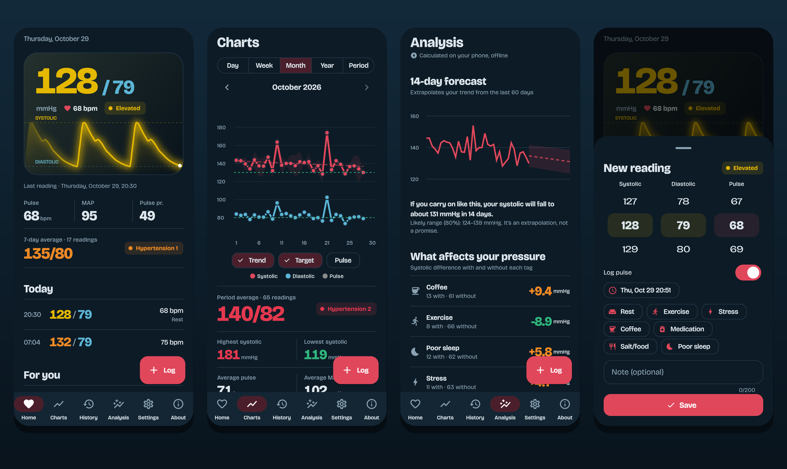

<div align="center">

# OhMyBlood

**Un diario de presión arterial privado y sin conexión para Android.**
Registra cada lectura, mira tu presión como una onda en directo y obtén previsiones y análisis calculados por completo en tu móvil.

[](https://github.com/drkbcn/ohmyblood-releases/releases/latest)


Español · [English](README.md)



</div>

Las capturas están en inglés; la app sigue el idioma de tu móvil.

## Por qué OhMyBlood

- **Tus datos se quedan en tu móvil.** Las lecturas se cifran con AES-256-GCM, la clave vive en el Keystore de Android y no hay cuentas, nube ni analítica.
- **Pensada para la medición domiciliaria real.** Varias lecturas al día, etiquetas como café o mal sueño, notas y recordatorios a las horas que elijas.
- **Análisis, no solo una lista de números.** Tendencias, previsión a 14 días, qué influye en tu presión, tus mejores y peores momentos del día y un informe para tu médico. Todo se calcula sin conexión.
- **Agradable de ver.** Una onda de presión en directo en la pantalla principal, tema claro y oscuro y gráficas fluidas.

## Funciones

- **Registro:** sistólica, diastólica y pulso con ruedas, categoría en directo, etiquetas y notas, y aviso si un valor se aleja mucho de lo habitual.
- **Gráficas:** día, semana, mes, año o periodo libre, con línea de tendencia, objetivo, franja mínimo–máximo y pulso opcional.
- **Estadísticas:** promedios, máximos y mínimos, presión arterial media, variabilidad, mañana frente a noche, porcentaje en objetivo y reparto por categoría.
- **Análisis sin conexión:** previsión a 14 días con banda de predicción, factores que influyen, perfil por franja horaria y día de la semana, lecturas atípicas e informe para el médico.
- **Recordatorios** diarios, hasta cuatro horas.
- **Seguridad:** datos cifrados, bloqueo opcional con huella o PIN y copia de seguridad de Android desactivada.
- **Exportación** a CSV.
- **Idiomas:** English, Español, Català, Italiano, Français, Русский, Ελληνικά y Português.

## Instalación

1. Descarga el APK de la [última versión](https://github.com/drkbcn/ohmyblood-releases/releases/latest).
2. Ábrelo en tu móvil. Android te pedirá permitir instalar apps desde ese origen.
3. Abre OhMyBlood y registra tu primera lectura.

Requiere Android 7.0 o superior. Se distribuye como APK desde GitHub; no está en Google Play.

**Verificar la descarga (opcional).** Todas las versiones se firman con la misma clave:

```
apksigner verify --print-certs ohmyblood-vX.Y.Z.apk
```

El SHA-256 del certificado debe ser:

```
8104ae0b592be5eae4ce8d54d5cffe3f6921754cfdca1045a8930dcf2f111df6
```

### Actualizaciones
Al arrancar, la app comprueba este repositorio como mucho una vez al día, y la pestaña **Acerca** tiene un botón **Buscar actualizaciones**. Solo te avisa de que hay una versión nueva; la descargas e instalas tú y tus datos se conservan.

## Privacidad

- Las lecturas se guardan cifradas (AES-256-GCM) en un fichero privado; la clave se genera en tu móvil y se guarda en el Keystore.
- No hay cuentas, anuncios ni rastreadores.
- La única conexión es a GitHub, para mostrar el avatar del autor y buscar versiones nuevas.
- Permisos: Internet (esos dos usos), notificaciones y arranque (recordatorios) y biometría (bloqueo opcional).

## Importante

OhMyBlood es informativa y no es un producto sanitario. No diagnostica ni trata nada y no sustituye a tu médico. Si tienes dolor de pecho, falta de aire, debilidad o cambios en la visión, busca atención urgente.

## Apoyo

OhMyBlood la hace una sola persona, sin anuncios ni cuentas. Si te resulta útil, puedes [invitarme a un café en Ko-fi](https://ko-fi.com/drkbcn).

El código fuente está en un repositorio privado; este contiene las versiones y la documentación.

---

<div align="center">

Hecha por [Manel Alonso (@drkbcn)](https://github.com/drkbcn)

</div>
