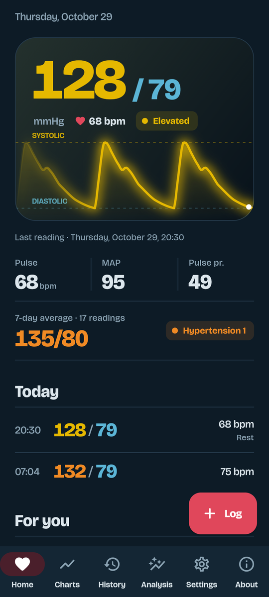
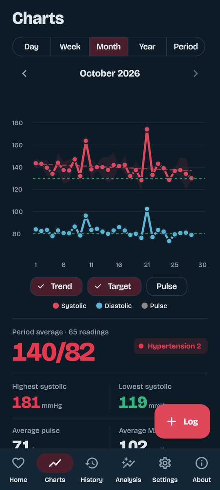
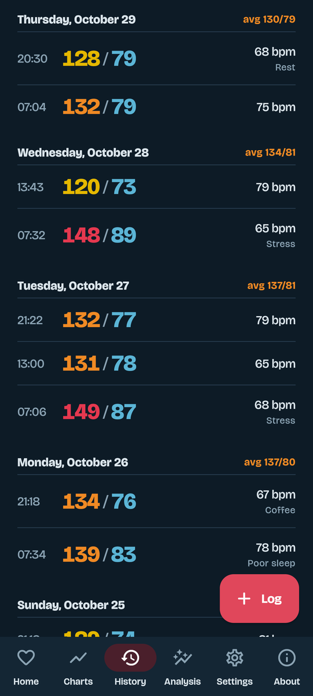
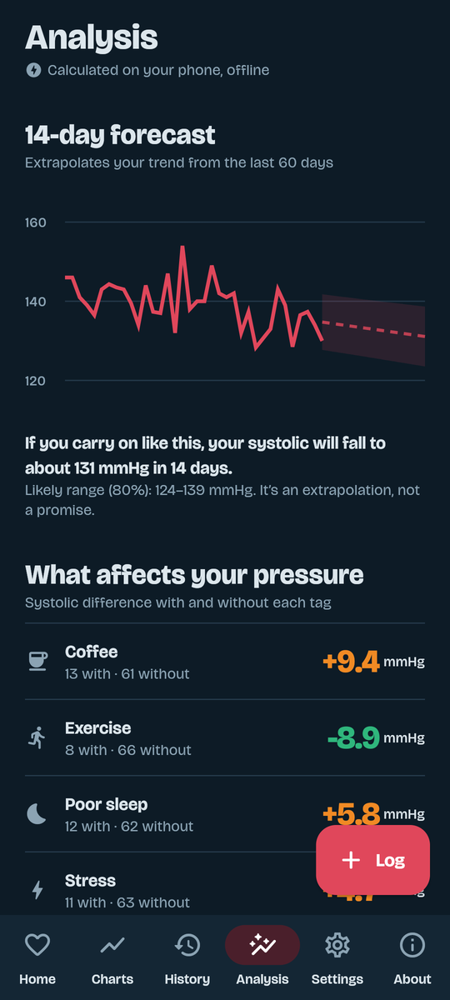
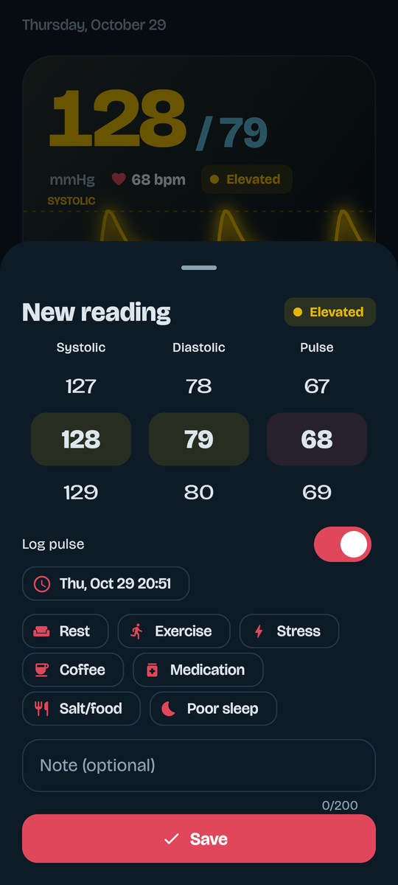
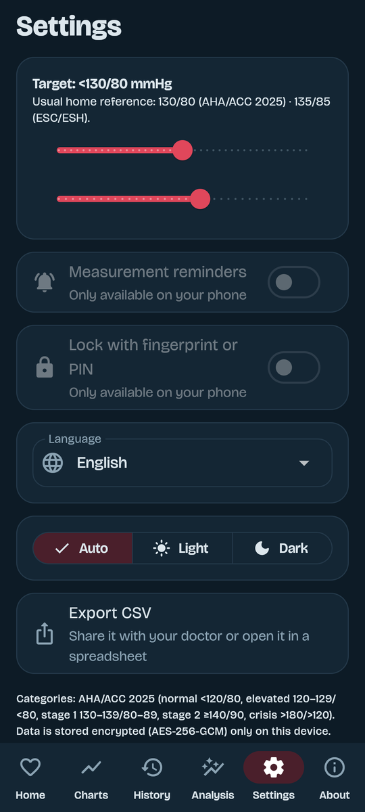
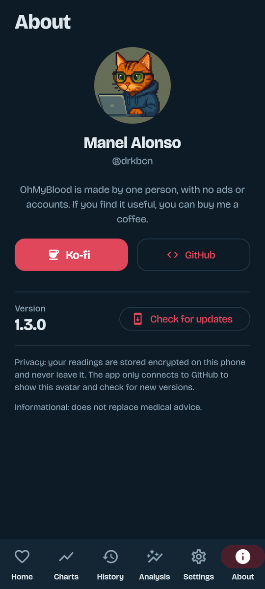
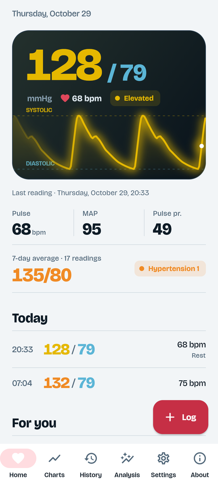

<div align="center">

# OhMyBlood

**A private, offline blood pressure diary for Android.**
Log every reading, watch your pressure as a live waveform, and get forecasts and insights computed entirely on your phone.

[](https://github.com/drkbcn/ohmyblood-releases/releases/latest)


[Español](README.es.md) · English


</div>

## Why OhMyBlood

- **Your data stays on your phone.** Readings are encrypted with AES-256-GCM, the key lives in the Android Keystore, and there are no accounts, no cloud and no analytics.
- **Built for the way home monitoring really works.** Several readings per day, tags such as coffee or poor sleep, notes, and reminders at the times you choose.
- **Insight, not just a list of numbers.** Trends, a 14-day forecast, what affects your pressure, your best and worst times of day, and a report you can hand to your doctor. All of it is calculated offline.
- **Pleasant to look at.** A live pressure waveform on the home screen, dark and light themes, smooth charts.

## Features

### Logging
- Systolic, diastolic and pulse on fast scroll wheels, with the category shown live while you pick the values.
- As many readings per day as you like, each with a time, optional tags (rest, exercise, stress, coffee, medication, salt/food, poor sleep) and a note.
- If a value is far from your usual range, the app suggests waiting a minute and measuring again before you save.
- Edit or delete any reading, with undo.

### Charts and statistics
- Day, week, month, year or any custom period, with arrows to move between periods.
- Systolic and diastolic lines, optional pulse, your target, the min–max band and a trend line.
- Averages, highest and lowest values, mean arterial pressure, variability, morning vs. evening, share of readings on target, and a breakdown by category.
- Trend expressed in mmHg per month, with its R² so you can tell signal from noise.

### Analysis (offline)
- **Forecast:** extrapolates your last 60 days 14 days ahead, with an 80 % prediction band.
- **What affects your pressure:** compares your systolic with and without each tag and tells you when the difference is reliable.
- **Your day and your week:** average systolic by time of day and by weekday.
- **Atypical readings:** flags measurements far from your 30-day median, which are probably errors, and leaves them out of the forecast and the factors.
- **Doctor report:** one tap shares a plain-text summary with 7, 30 and 90-day averages, the home average, trend and your latest readings.

### Reminders, security and export
- Daily reminders at up to four times of your choice.
- Optional lock with fingerprint or device PIN.
- Android backup is disabled, so your readings do not end up in a cloud backup.
- Export everything as CSV.

### Languages and themes
English, Español, Català, Italiano, Français, Русский, Ελληνικά and Português, following the phone language or chosen in Settings. Light, dark or automatic theme.

## Screenshots

<table>
  <tr>
    <td></td>
    <td></td>
    <td></td>
    <td></td>
  </tr>
  <tr>
    <td align="center">Home</td><td align="center">Charts</td><td align="center">History</td><td align="center">Analysis</td>
  </tr>
  <tr>
    <td></td>
    <td></td>
    <td></td>
    <td></td>
  </tr>
  <tr>
    <td align="center">New reading</td><td align="center">Settings</td><td align="center">About</td><td align="center">Light theme</td>
  </tr>
</table>

The screenshots use sample data.

## Install

1. Download the APK from the [latest release](https://github.com/drkbcn/ohmyblood-releases/releases/latest).
2. Open it on your phone. Android will ask you to allow installing apps from this source; accept for the browser or file manager you used.
3. Open OhMyBlood and log your first reading.

Requires Android 7.0 or newer. It is distributed as an APK from GitHub and is not on Google Play.

**Verify the download (optional).** Every release is signed with the same key. You can check it with `apksigner` from the Android SDK:

```
apksigner verify --print-certs ohmyblood-vX.Y.Z.apk
```

The certificate SHA-256 digest must be:

```
8104ae0b592be5eae4ce8d54d5cffe3f6921754cfdca1045a8930dcf2f111df6
```

### Updates
OhMyBlood checks this repository for a newer release at most once a day when it starts, and the **About** tab has a **Check for updates** button. It only tells you a new version exists; you download and install it yourself, and your data is kept.

## Privacy and security

- Readings are stored in a private file, encrypted with AES-256-GCM. The key is generated on your phone and kept in the Android Keystore.
- There are no accounts, ads, trackers or analytics.
- The only network use is to GitHub, to show the author avatar in **About** and to look for new releases.
- Permissions: Internet (the two uses above), notifications and boot completed (daily reminders), and biometrics (optional lock).
- If the encrypted file ever cannot be read, the app moves it aside instead of overwriting it and tells you.

## How the numbers are calculated

| Item | Method |
|---|---|
| Categories | AHA/ACC 2025: normal <120/80, elevated 120–129 and <80, stage 1 130–139 or 80–89, stage 2 ≥140 or ≥90, crisis >180 or >120 |
| Mean arterial pressure | diastolic + (systolic − diastolic) / 3 |
| Trend | least-squares line over daily averages, in mmHg per month; needs 4 days spread over a week or more |
| Forecast | the same line projected 14 days, with an 80 % prediction interval from the residuals |
| Variability | standard deviation of the systolic |
| Atypical reading | systolic ≥20 mmHg and more than 3.5 robust deviations (MAD) from your 30-day median, or diastolic ≥12 mmHg away |
| Tag effect | difference of means with and without the tag (Welch); marked reliable with at least 8 readings per group and \|t\| ≥ 2 |
| Home average | the last 7 days, excluding the first day, in the doctor report |

The target defaults to 130/80 mmHg (AHA/ACC) and can be changed in Settings; 135/85 is the usual home threshold in European guidance. See the [2025 AHA/ACC guideline](https://www.ahajournals.org/doi/10.1161/HYP.0000000000000249).

## Important

OhMyBlood is informational and is not a medical device. It does not diagnose or treat anything and does not replace your doctor. If you have chest pain, shortness of breath, weakness or vision changes, seek urgent care.

## Support

OhMyBlood is made by one person, with no ads or accounts. If it is useful to you, you can [buy me a coffee on Ko-fi](https://ko-fi.com/drkbcn).

The source code is in a private repository; this one holds the releases and the documentation.

---

<div align="center">

Made by [Manel Alonso (@drkbcn)](https://github.com/drkbcn)

</div>
